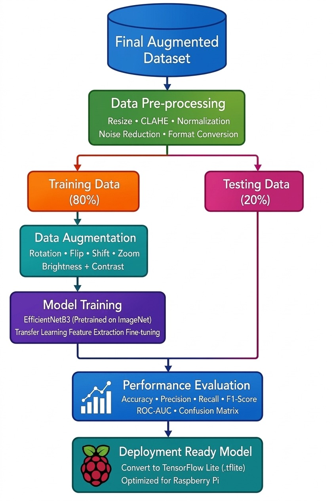
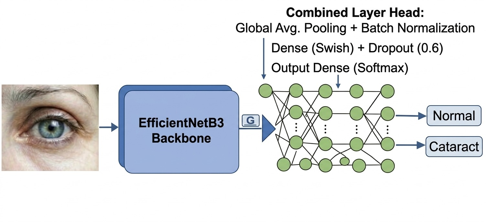
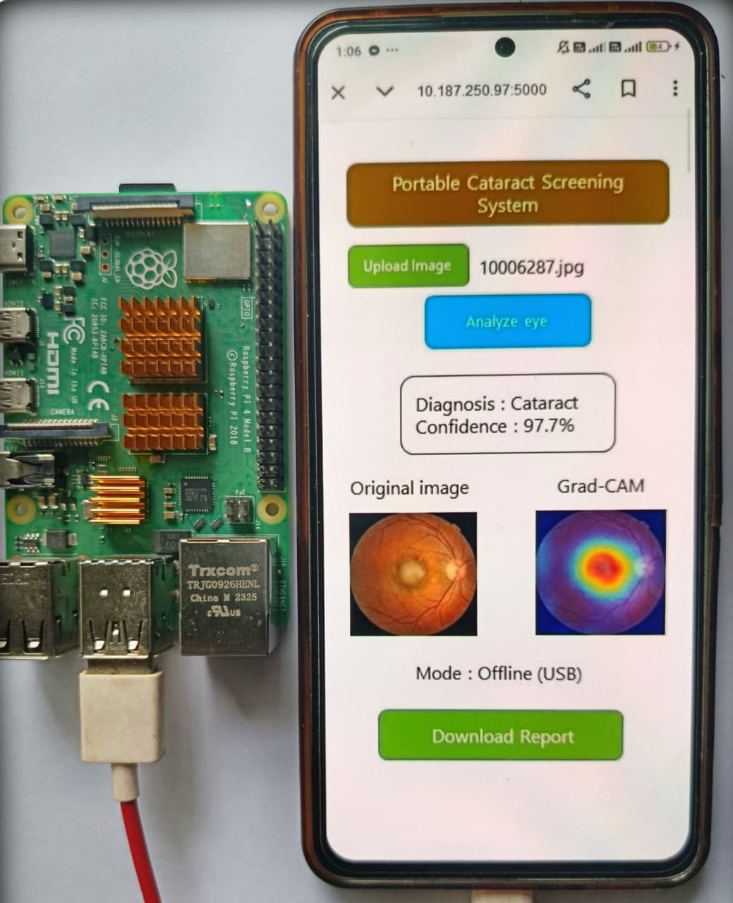

# CataNet-B3: Raspberry Pi-Based Portable Cataract Screening System

A machine-learning project exploring affordable, portable, and offline cataract screening using a smartphone camera and Raspberry Pi.

## Project Overview

CataNet-B3 is a machine-learning-based project designed to classify ocular images into two categories: **Normal** and **Cataract**. The system combines image preprocessing and EfficientNet-B3 transfer learning with a Raspberry Pi-based inference system.

A smartphone camera fitted with a 15× clip-on macro lens is used to capture ocular images. The captured images are processed by the model running on a Raspberry Pi, and the predicted result is displayed through a mobile interface over a local network.

The main goal is to explore a portable and affordable approach to preliminary cataract screening, particularly in areas where specialist equipment and reliable internet access may be limited.

**Note:** This is a research and development prototype, not a clinically validated medical device. Its predictions should not replace examination by a qualified eye-care professional.

## Project Objectives

- Develop a portable prototype for preliminary cataract screening.
- Capture ocular images using a smartphone camera with a 15× clip-on macro lens.
- Apply image preprocessing to improve input consistency and contrast.
- Use transfer learning to classify images into Normal and Cataract categories.
- Run model inference on a Raspberry Pi.
- Display predictions through a mobile interface over a local network.
- Explore an offline screening workflow that does not require internet access during inference.

## Key Features

- **Portable system:** Smartphone camera, macro lens, and Raspberry Pi.
- **Binary classification:** Normal and Cataract.
- **Deep learning:** EfficientNet-B3 pretrained on ImageNet.
- **Image preprocessing:** Image resizing, pixel normalization, and CLAHE.
- **On-device inference:** Designed to run the trained model on a Raspberry Pi.
- **Offline operation:** Local communication between the smartphone and Raspberry Pi.
- **Performance evaluation:** Accuracy, precision, recall, F1-score, AUC-ROC, and confusion matrix.

## System Workflow

The proposed system follows these steps:

1. **Image Capture:** Capture an ocular image using a smartphone camera with a 15× clip-on macro lens.
2. **Image Preprocessing:** Resize the image to 224 × 224 pixels, rescale pixel values, and apply Contrast Limited Adaptive Histogram Equalization (CLAHE).
3. **Image Transfer:** Send the image to the Raspberry Pi through a local network.
4. **Model Inference:** Process the image using the trained CataNet-B3 model.
5. **Classification:** Predict one of two classes: Normal or Cataract.
6. **Result Display:** Return the predicted result to the mobile interface.

### Workflow Diagram



## Model Architecture

CataNet-B3 uses EfficientNet-B3 as its feature-extraction backbone. The architecture configuration is summarized below.

| Layer | Configuration | Purpose |
|---|---|---|
| Input | 224 × 224 × 3 RGB image | Receives the ocular image |
| Preprocessing | CLAHE and rescaling | Improves contrast and scales pixel values |
| Backbone | ImageNet-pretrained EfficientNet-B3 | Extracts image features |
| Global Average Pooling | 1,536 features | Converts feature maps into a feature vector |
| Batch Normalization | 1,536 features | Normalizes intermediate activations |
| Dense Layer | 512 units, Swish activation | Learns task-specific features |
| Dropout | Rate 0.6 | Helps reduce overfitting |
| Output Layer | 2 units, Softmax | Predicts Normal or Cataract |

### Architecture Diagram



## Dataset

The project uses selected Normal and Cataract images from publicly available ocular-image datasets:

- ODIR-5K
- RFMiD
- Kaggle Eye Disease Dataset

Only the Normal and Cataract categories are selected for the binary classification task.

The current project records the following dataset distribution:

| Dataset Stage | Normal | Cataract | Total |
|---|---:|---:|---:|
| Initial Dataset | 2,893 | 603 | 3,496 |
| Training Set | 1,200 | 1,200 | 2,400 |
| Testing Set | 367 | 233 | 600 |

These counts should be checked against the final dataset and training code before reproducing the experiments.

**Dataset note:** Images from third-party datasets should not be redistributed unless their licenses and usage terms explicitly permit it.

## Experimental Results

The current project experiment reports the following test-set performance:

| Metric | Result |
|---|---:|
| Accuracy | 97.33% |
| Precision | 94.64% |
| Recall | 98.71% |
| F1-Score | 96.63% |
| AUC-ROC | 99.1% |

These values represent the project's reported experimental results and have not been independently verified. Performance may vary depending on dataset composition, preprocessing, data splitting, and training configuration.

### Training and Evaluation Figures

**Training vs. Testing Accuracy**


**Training vs. Testing Loss**


**Confusion Matrix**


## Hardware Requirements

The project hardware includes:

- Raspberry Pi 4
- Smartphone with a camera
- 15× clip-on macro lens
- Local Wi-Fi or network connection between the smartphone and Raspberry Pi

### Hardware Setup



## Technologies Used

- Python
- Deep Learning
- EfficientNet-B3
- Transfer Learning
- TensorFlow/Keras and/or PyTorch, depending on the final implementation
- OpenCV
- NumPy
- Raspberry Pi
- Image Processing
- Local Network Communication

The exact library versions and dependencies should be documented in a `requirements.txt` file based on the actual source code.

## System Architecture

The smartphone acts as the image-capture and user-interface device, while the Raspberry Pi performs model inference. Both devices communicate through a local network.


## Repository Structure

```text
CataNet-B3/
│
├── README.md
├── images/
│   ├── Workflow.jpeg
│   ├── Architecture.jpeg
│   ├── Training Vs Testing Accuracy Curve.jpeg
│   ├── Training Vs Testing Loss Curve.jpeg
│   ├── Confusion Matrix.jpeg
│   ├── System Architecture.jpeg
│   └── Hardware.jpeg
│
├── src/
│   ├── preprocessing.py
│   ├── train.py
│   ├── evaluate.py
│   └── inference.py
│
├── models/
│   └── trained model or download instructions
│
├── requirements.txt
├── .gitignore
└── LICENSE
```

This is a suggested structure. Include only the source files and folders that are actually available in your repository.


## Running the System

The intended workflow is:

1. Prepare the Raspberry Pi and connect it to the local network.
2. Start the inference service on the Raspberry Pi.
3. Open the mobile interface on the smartphone.
4. Capture or upload an ocular image.
5. Preprocess the image using the same settings used during training.
6. Run inference using the trained CataNet-B3 model.
7. View the predicted class on the mobile interface.

The exact execution commands will depend on the implementation included in the repository.

## Limitations

- The system is a research prototype and is not clinically validated.
- A model prediction cannot confirm or rule out cataract.
- Image focus, illumination, camera differences, and dataset bias may affect performance.
- Test-set results do not guarantee performance on new populations or devices.
- Independent evaluation and clinical validation are required before considering real-world medical use.

Anyone concerned about their vision should consult a qualified eye-care professional.

## Future Development

Potential improvements include:

- Testing the model on independent datasets.
- Evaluating sensitivity, specificity, and calibration.
- Measuring inference speed and memory consumption on Raspberry Pi.
- Adding image-quality checks for blur, illumination, and framing.
- Integrating explainable AI methods.
- Improving the mobile interface and local communication.
- Exploring additional ocular conditions after appropriate data collection and validation.

## Project Contributors

**MD Mahi Hossen Apon**  
Department of Electrical and Electronic Engineering  
Rajshahi University of Engineering & Technology (RUET), Rajshahi, Bangladesh

**Md Mayenul Islam**  
Department of Electrical and Electronic Engineering  
Rajshahi University of Engineering & Technology (RUET), Rajshahi, Bangladesh

## Acknowledgements

This project explores publicly available ocular-image datasets, including ODIR-5K, RFMiD, and a Kaggle Eye Disease Dataset. Please acknowledge the original dataset creators when using their data and follow their respective access and usage terms.
